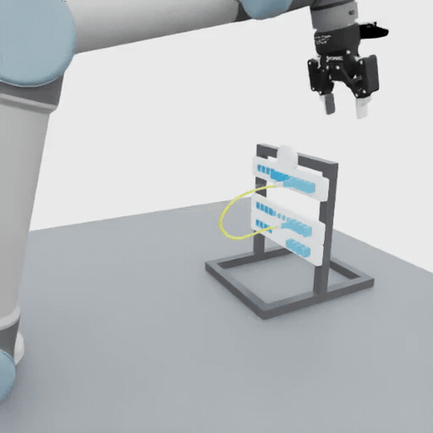

# Live Isaac Sim and Isaac Lab GPU verification

Executed in NVIDIA's `nvcr.io/nvidia/isaac-lab:2.2.0` container (Isaac Sim 5.0 + Isaac Lab 2.2.0, Vulkan headless) with `WIRECRAFT_ROBOT_ASSET_DIR` pointing to `ur5_with_gripper_camera_v2.usd`:
- **20-environment verification matrix, Table I sensor configs 1–6, and PhysX sensor tests**: NVIDIA GeForce RTX 3090 (24 GB VRAM, driver `580.142`).
- **Continuous 1x real-time frame-by-frame video and GIF gallery**: NVIDIA GeForce RTX 4090 (24 GB VRAM, driver `570.169`), recorded at full control rate (`render_stride=1`, `60 fps`, `360` steps = `6.00 s`, `--driver sweep --no-mid-resets`) and encoded to exact-1x `25 fps` (`40 ms` frame delay, `480x480`) GIFs.

## Summary of live checks

- **20-environment verification matrix** ([matrix_report.md](matrix_report.md), [matrix_report.json](matrix_report.json)): **20/20 passed**, `0` physics faults, `0` errors, `0` non-finite tensors across both robots (`Franka`, `UR5`), both wire backends (`Articulation`, `Deformable` CUDA FEM), and all 5 IDB Board #1 tasks (`num_envs=2`, `steps=60`, `driver=random`, partial and full resets exercised on every environment).
- **Kinematic board pose sync and polishing contact sensor** ([physx_sensors_check.json](physx_sensors_check.json)): randomized per-environment board poses synchronized `/frame` (`0.0 mm` error), `/polishing_pad` (`0.0 mm` error), and `/ports/A5` (`0.0 mm` error) directly in PhysX; pressing the active connector against `/idb_board/polishing_pad` triggered the dedicated `ContactSensor` (`0.3927 N` peak normal force).
- **Table I multimodal sensor configs 1 through 6** (`results/*.json`): all 6 sensor configs passed live (`exit 0`, zero errors, zero non-finite tensors) with `TiledCamera` RGB/depth/ToF rendering enabled.
- **1x frame-by-frame rollout gallery** (`videos/*.mp4`, `gifs/*.gif`): all 6 continuous 6-second rollouts across all 4 scene variations (`sparse`, `medium`, `dense`, `randomized`), both robots, and both wire backends passed with **0 faults** and **0 errors**.

## Rollout gallery

The first two GIFs below are embedded in the top-level [README.md](../README.md). All six 1x GIFs (`480x480`, `25 fps`, `6.00 s`), 60 fps source MP4 recordings (`videos/`), and Table I sensor verification logs (`results/`) are archived in this directory.

| Demo | Task ID | Variation | Wire Backend | 1x Capture Faults | Table I Sensor Config Log | Artifacts |
| --- | --- | --- | --- | --- | --- | --- |
| Franka SC fiber maintenance | `IDB-Franka-Articulation-SCFiberMaintenance-v0` | `medium` (6 neighbors + clips) | Articulation | 0 | Config 1 (`wrist_d405_rgb`, `scene_d435i_rgb`, F/T) | [GIF](gifs/franka_art_sc_maintenance_medium.gif) · [MP4](videos/franka_art_sc_maintenance_medium.mp4) · [JSON](results/franka_art_sc_maintenance_medium.json) |
| UR5 SC port swap (CUDA FEM) | `IDB-UR5-Deformable-SCPortSwap-v0` | `medium` (6 neighbors + clips) | Deformable FEM | 0 | Config 4 (`wrist_d405_rgb`, `scene_d435i_depth`, F/T) | [GIF](gifs/ur5_fem_sc_swap_medium.gif) · [MP4](videos/ur5_fem_sc_swap_medium.mp4) · [JSON](results/ur5_fem_sc_swap_medium.json) |
| Franka LC maintenance (CUDA FEM) | `IDB-Franka-Deformable-LCFiberMaintenance-v0` | `sparse` | Deformable FEM | 0 | Config 3 (`wrist_d405_rgb`, `wrist_d405_depth`, F/T) | [GIF](gifs/franka_fem_lc_maintenance_sparse.gif) · [MP4](videos/franka_fem_lc_maintenance_sparse.mp4) · [JSON](results/franka_fem_lc_maintenance_sparse.json) |
| Franka LC duplex swap (randomized) | `IDB-Franka-Articulation-LCDuplexPortSwap-v0` | `randomized` (pose, physics, lighting, port) | Articulation | 0 | Config 5 (`wrist_d405_depth`, F/T) | [GIF](gifs/franka_art_lc_duplex_randomized.gif) · [MP4](videos/franka_art_lc_duplex_randomized.mp4) · [JSON](results/franka_art_lc_duplex_randomized.json) |
| UR5 Ethernet port swap (dense) | `IDB-UR5-Articulation-EthernetPortSwap-v0` | `dense` (12 neighbors + clips + jitter) | Articulation | 0 | Config 2 (`wrist_d405_rgb`, `scene_adtf3175_tof`, F/T) | [GIF](gifs/ur5_art_ethernet_swap_dense.gif) · [MP4](videos/ur5_art_ethernet_swap_dense.mp4) · [JSON](results/ur5_art_ethernet_swap_dense.json) |
| UR5 LC fiber maintenance | `IDB-UR5-Articulation-LCFiberMaintenance-v0` | `sparse` | Articulation | 0 | Config 6 (`wrist_d405_rgb`, no F/T) | [GIF](gifs/ur5_art_lc_maintenance_sparse.gif) · [MP4](videos/ur5_art_lc_maintenance_sparse.mp4) · [JSON](results/ur5_art_lc_maintenance_sparse.json) |

### Additional rollout previews

| Franka Deformable LC Maintenance (`sparse`, 1x real-time) | Franka Articulation LC Duplex Swap (`randomized`, 1x real-time) |
| --- | --- |
|  |  |

| UR5 Articulation Ethernet Swap (`dense`, 1x real-time) | UR5 Articulation LC Maintenance (`sparse`, 1x real-time) |
| --- | --- |
|  |  |
